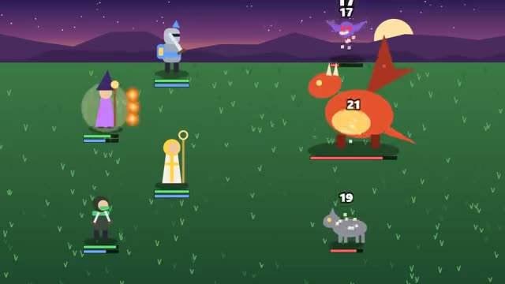

# Party Battles

Pick your hero's move. Beat the waves, then the boss. A multiplayer starter game from [Multiplayer Agent](https://multiplayeragent.com): 2D, co-op, 1–4 players, with bots that play any hero nobody has.

## How it plays

Your party of four (a knight, a mage, a cleric and a rogue) fights wave after wave of monsters. Every turn each player picks their hero's move: attack, a class skill, a potion or defend. Every fifth wave is a boss; see how far the party gets.

**Controls:** Click or tap an action, then a target; keys 1 to 4 pick an action.

## Make it yours in the Game Builder

Open the [Game Builder](https://multiplayeragent.com), choose **Start from a starter game** and pick Party Battles. It opens as version 1 in your studio, ready to play and publish. Then ask for changes, for example:

- Add a fifth hero, a bard who buffs the party
- Let players spend gold on new skills between waves
- Make the boss a giant robot with a laser attack

## Run it yourself

1. Get a free publishable key (`pk_…`) at [multiplayeragent.com](https://multiplayeragent.com).
2. In `index.html`, put it in place of `pk_REPLACE_ME` in the `MP_CONNECT` block.
3. Open `index.html` in a browser. No build step and no server needed.

Without a key it still runs, offline with bots playing the other heroes.

## How it is built

- One `index.html`. The comment at the top of the script maps the code and explains the multiplayer.
- **Leaderboard:** The most waves each player's party cleared.
- **Host-run rules:** The host's browser resolves every turn and plays the monsters; if it leaves, the next player takes over the same turn.
- **Bots:** Bots play any hero nobody has picked, and take over for anyone who leaves.
- **Live sync:** Everyone sees each other's picks and the same turn play out.
- `?attract` runs it offline with bots only. The preview video is recorded from it.

## License

MIT.
